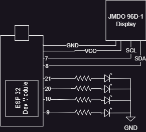

<div align="center">

# 🎮 Signal Tower
### RC Controller → Arduino → PC Keyboard Emulator

**Turn an existing RC car controller into a wireless game controller.**

A hardware–software project by **[Dev Shehan](https://github.com/devshehan6)**, built with Arduino and Python.

[](https://www.python.org/)
[](https://www.arduino.cc/)
[](https://www.microsoft.com/windows)
[](https://customtkinter.tomschimansky.com/)

</div>

---

## 📌 Overview

**Signal Tower** reads button signals from an RC car receiver and sends them to a computer through USB serial communication. A Python desktop application converts the received signals into keyboard presses, allowing the RC controller to control compatible PC games.

The project also includes a physical signal tower with four LEDs and an OLED display. The display shows a startup animation, project branding, elapsed time, and the four input states.

## ✨ Features

- 📡 Reuses an RC car controller and receiver as the wireless input source.
- 🔌 Sends four digital input states from the Arduino to the PC over USB serial.
- ⌨️ Maps controller inputs to either **W/A/S/D** or **Arrow Keys**.
- 🖥️ Dark-themed Python GUI built with CustomTkinter.
- 🔎 Detects available serial/COM ports and lets you refresh the list.
- ⚙️ Configures the COM port, baud rate, keyboard layout, and game executable.
- 💾 Saves settings to `config.json`.
- 🎮 Launches a selected game from the GUI.
- 📟 OLED status screen with a welcome screen, project name, timer, and input indicators.
- 💡 Four-LED animation for the physical signal tower.
- 🧾 Live log showing serial signals and currently active keys.

## 🎥 Project Videos

> Keep the video files in the repository's `data/` folder using the filenames below. If your GitHub README renderer does not play the embedded videos, use the **Open video** links to view or download them.

### 1. Signal Tower hardware

See the physical tower and its display.

<video src="data/tower.mp4" controls width="100%"></video>

[▶ Open / download `tower.mp4`](data/tower.mp4)

### 2. Connect the device and launch a game

Walkthrough of connecting the device and loading a game.

<video src="data/connectAndLoadGame.mp4" controls width="100%"></video>

[▶ Open / download `connectAndLoadGame.mp4`](data/connectAndLoadGame.mp4)

### 3. Gameplay demonstration

See the RC controller inputs being used to play a game.

<video src="data/playGame.mp4" controls width="100%"></video>

[▶ Open / download `playGame.mp4`](data/playGame.mp4)

## 🧩 Circuit Diagram

### Circuit image



### Editable diagram

[📥 Download / open the editable Draw.io diagram](data/diagram.drawio)

You can open the `.drawio` file with [diagrams.net](https://app.diagrams.net/) to inspect or edit the circuit diagram.

## 🏗️ How It Works

```text
RC Controller
     │  wireless radio signal
     ▼
RC Car Receiver
     │  four digital output signals
     ▼
Arduino Signal Tower
     ├── Reads the four input pins
     ├── Updates the OLED display
     ├── Runs the four-LED animation
     └── Sends a 4-bit signal over USB serial
                    │
                    ▼
             Python Desktop GUI
             ├── Reads serial data
             ├── Detects active inputs
             └── Presses/releases PC keys
                    │
                    ▼
               PC Game 🎮
```

1. Press a direction button on the RC controller.
2. The receiver changes its digital output signal(s).
3. The Arduino reads the four input pins and sends their states through USB serial at **115200 baud**.
4. The Python app reads the serial data and translates each input into a keyboard key.
5. The selected game receives the keyboard input.

## 🔢 Signal Format and Key Mapping

The Arduino sends the inputs in this order:

```text
B C A D
```

The Python application expects a four-character binary string. A `0` means the corresponding input is active, and a `1` means it is inactive.

| Serial position | Arduino input | Python action | W/A/S/D mode | Arrow mode |
|---|---|---|---|---|
| 1 | B | Right (`R`) | `D` | `→` |
| 2 | C | Forward (`F`) | `W` | `↑` |
| 3 | A | Left (`L`) | `A` | `←` |
| 4 | D | Backward (`B`) | `S` | `↓` |

**Example:** `1111` means all four inputs are inactive. The Python app releases any keys that are no longer active.

> **Important:** The mapping above follows the supplied Arduino and Python code. Confirm that your receiver wiring and controller directions match it.

## 🧰 Hardware

The supplied sketch uses the following connections:

| Component / signal | Arduino pin |
|---|---:|
| Receiver input A | 21 |
| Receiver input B | 20 |
| Receiver input C | 10 |
| Receiver input D | 9 |
| OLED SDA | 8 |
| OLED SCL | 7 |
| LED output 1 | 0 |
| LED output 2 | 1 |
| LED output 3 | 2 |
| LED output 4 | 3 |

Other hardware:
- RC car transmitter/controller and its compatible receiver
- Arduino-compatible board that supports the pins and functions used by the sketch
- 128 × 64 SSD1306 OLED display (I²C address `0x3C` in the supplied code)
- Four LEDs with appropriate current-limiting resistors
- USB cable for serial communication with the PC
- Wiring and a suitable power supply

**Board compatibility note:** The sketch uses `INPUT_PULLDOWN` and `analogWrite()`. Check that your specific Arduino-compatible board supports these features and the listed pin assignments before wiring. Pins `0` and `1` may also be used for serial communication on some boards, so verify the board pinout.

## 💻 Software

### Python desktop application

The GUI uses these Python packages:

- `pyserial` — serial-port communication
- `customtkinter` — modern desktop interface
- `pynput` — keyboard press/release control

The remaining modules used by the Python code (`tkinter`, `time`, `json`, `os`, `threading`, and `subprocess`) are part of Python's standard library on supported desktop installations.

### Arduino libraries

Install these libraries using the Arduino IDE Library Manager:

- **Adafruit GFX Library**
- **Adafruit SSD1306**

`Wire` is included with the Arduino platform/core.

## 🚀 Setup and Usage

### 1. Upload the Arduino sketch

1. Open the Arduino sketch in Arduino IDE.
2. Install the Adafruit GFX and Adafruit SSD1306 libraries.
3. Check the pin assignments against your board and wiring.
4. Select the correct board and USB/serial port.
5. Upload the sketch.

### 2. Install Python dependencies

Open a terminal in the folder containing the Python application and run:

```bash
python -m pip install pyserial customtkinter pynput
```

If the system uses the Python launcher instead, use the Python command configured on your computer.

### 3. Connect the hardware

1. Connect the Arduino to the computer with USB.
2. Close Arduino Serial Monitor and any other program using the same COM port.
3. Start the Python application.
4. Click **Refresh** and select the Arduino's COM port.
5. Set the baud rate to **115200**, matching the Arduino sketch.

### 4. Configure keyboard controls

- Choose **W A S D** or **Arrow Keys**.
- Optionally browse for a game's `.exe` file.
- Click **Save Config** to store your settings.

The application creates or updates `config.json` beside the Python script.

### 5. Play a game

1. Click **Start Controller**.
2. Click **Run Game** if you selected a game executable, or launch your game normally.
3. Make sure the game window has keyboard focus.
4. Use the RC controller to control the game.
5. Click **Stop Controller** when finished.

## 🖥️ Python GUI

The desktop application includes:

- **COM Port** — choose the Arduino's serial port.
- **Refresh** — rescan available serial ports.
- **Baud Rate** — select the serial speed; it must match the Arduino sketch.
- **Controller** — switch between W/A/S/D and arrow-key layouts.
- **Game EXE / Browse** — choose a Windows game executable.
- **Start / Stop Controller** — begin or stop reading controller signals.
- **Run Game** — launch the selected executable.
- **Save Config** — save application settings.
- **Live Log** — display received signal states and active keys.

## 📁 Repository Structure

```text
.
├── README.md
├── <python-app>.py
├── <arduino-sketch>.ino
└── data/
    ├── connectAndLoadGame.mp4
    ├── playGame.mp4
    ├── tower.mp4
    ├── signelToverDiagram.png
    └── diagram.drawio
```

`<python-app>.py` and `<arduino-sketch>.ino` are placeholders for the actual filenames. Keep the media and diagram files in `data/` with the exact names shown above, or update the links in this README if you rename them.

## 🛠️ Troubleshooting

| Problem | What to check |
|---|---|
| No COM port appears | Check the USB cable, board connection, drivers, and Device Manager; then click **Refresh**. |
| Serial port fails to open | Close Arduino Serial Monitor and other programs using the port. Confirm the selected COM port and baud rate. |
| No keyboard input in game | Start the controller, focus the game window, verify the selected key layout, and check the Live Log. |
| Keys remain active unexpectedly | Stop the controller to release tracked keys, then check receiver signals and the serial connection. |
| Game does not launch | Confirm that the selected `.exe` path exists and that the game can be launched directly. |
| OLED is blank | Check SDA/SCL wiring, power, the I²C address (`0x3C`), and the installed display libraries. |
| Inputs appear reversed | Verify receiver-to-Arduino wiring and the B-C-A-D serial order, then check the key mapping. |
| LEDs do not animate | Check LED wiring, current-limiting resistors, pin support, and the selected board's `analogWrite()` behavior. |

## ⚠️ Notes and Limitations

- The project is designed around the signal format and pin assignments in the supplied source code.
- The Python code uses Windows-style COM ports and launches Windows `.exe` files.
- Some games, especially those running with elevated permissions, may not accept simulated keyboard input from a normal-permission application. Only use this with games and software where keyboard automation is permitted.
- Do not connect receiver outputs directly until their voltage levels are confirmed to be safe for the selected board's input pins.
- Confirm the board pinout before using pins `0`–`3`, `7`–`10`, `20`–`21`; pin capabilities vary by board.
- The project has not been independently tested across every board, operating system, or game.

## 👨‍💻 Author

**Dev Shehan**

- GitHub: [@devshehan6](https://github.com/devshehan6)

Built as an electronics and programming project combining RC radio control, embedded systems, serial communication, and desktop automation.

---

<div align="center">

**If you find this project interesting, consider giving the repository a ⭐**

</div>
